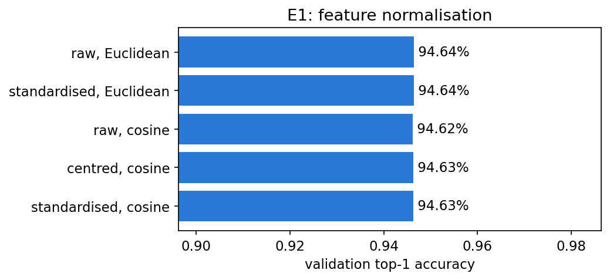
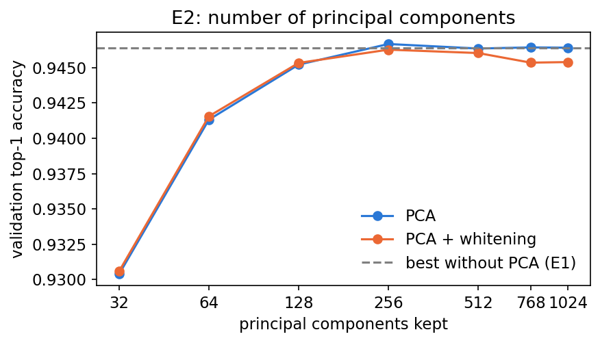
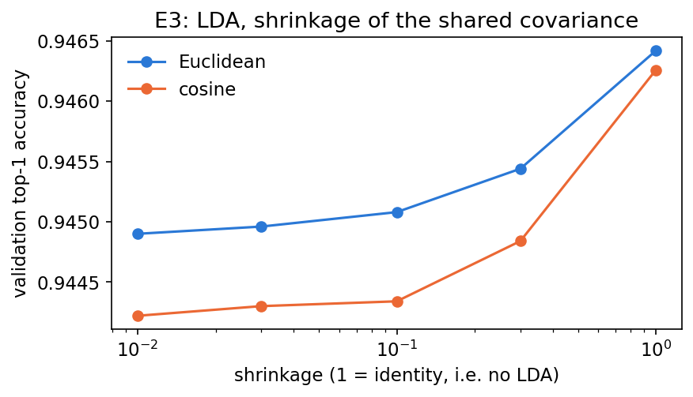
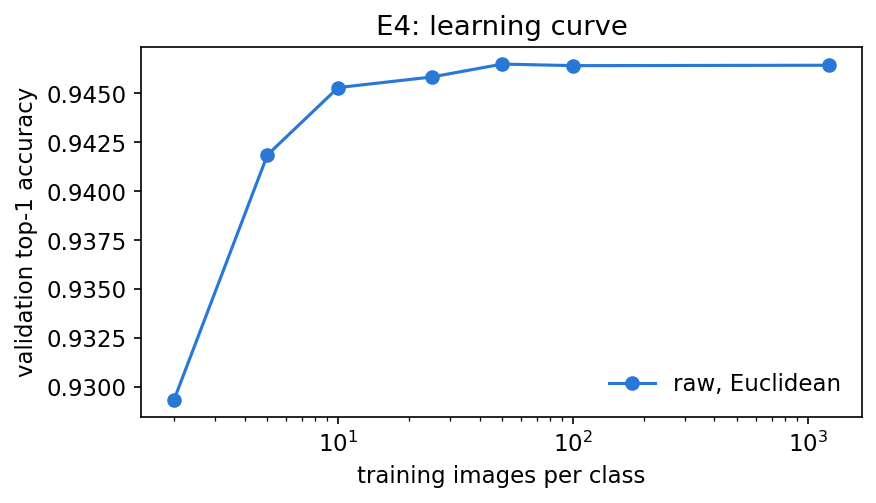
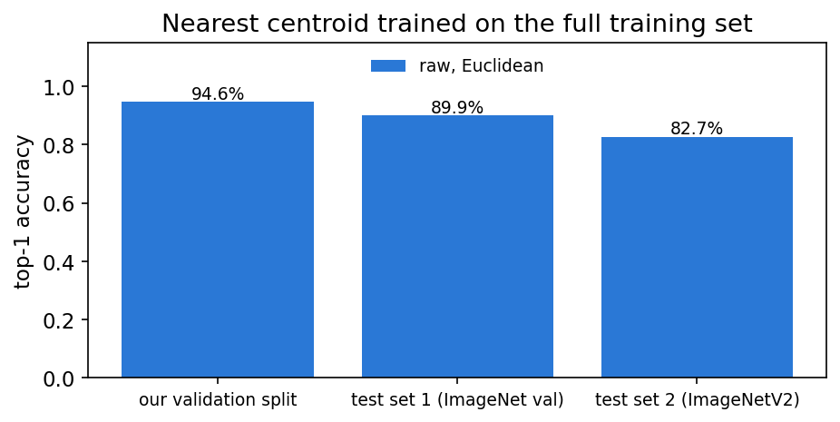
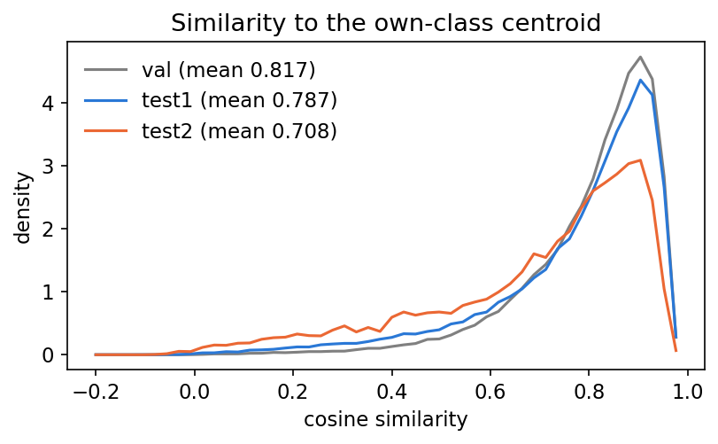

# Classifier C: Nearest Centroid

## 1. Method

Each class is represented by its centroid, the mean of its training feature vectors. A test image is assigned to the
class whose centroid is closest. The model has no weights to optimise, so it can be trained on all 1.23 million
training images in one pass over the memory-mapped data.

## 2. Experimental setup

- **Training data:** `train_small` (100 images per class) for all variants.
- **Model selection:** our validation split (50 images per class, taken from the training set). The test sets were
  not used.
- **Selection rule:** the standard error of validation accuracy is 0.1 points (50,000 images). We chose the
  simplest variant within one standard error of the best.
- **Final model:** refitted on the full training set (validation rows excluded) and evaluated once on both test sets.

Four experiments were run:

| ID | Question | Variants |
|---|---|---|
| E1 | Does normalisation help? | raw, standardised, cosine, centred + cosine, standardised + cosine |
| E2 | How many dimensions are needed? | PCA with 32 to 1,024 components, with and without whitening |
| E3 | Does a Mahalanobis distance help? | LDA with shrinkage 0.01 to 1 |
| E4 | How much data is needed? | 2 to 100 images per class, and the full training set |

## 3. Results

**Variants.** No variant was better than the baseline (raw features, Euclidean distance) by more than one standard
error.

| Experiment | Validation top-1 |
|---|---|
| Baseline (raw, Euclidean) | 94.64% |
| E1 Normalisation | 94.62 - 94.64% |
| E2 PCA, 256 to 1,024 components | 94.54 - 94.67% |
| E2 PCA, 32 components | 93.04% |
| E3 LDA | 94.42 - 94.54% |

All normalisations give the same accuracy (Figure 1). PCA needs about 256 components to reach full accuracy
(Figure 2). LDA is slightly worse than the plain distance and approaches it as shrinkage goes to 1 (Figure 3). Two
images per class already give 92.9% and ten give 94.5%; more data adds almost nothing (Figure 4). The selected model
is therefore the baseline.

*Figure 1. Validation accuracy for five normalisations (E1).*

*Figure 2. Validation accuracy against the number of PCA components (E2).*

*Figure 3. Validation accuracy against LDA shrinkage; 1 means no LDA (E3).*

*Figure 4. Validation accuracy against training images per class (E4).*

**Test sets.**

| Set | Top-1 | Top-5 |
|---|---|---|
| Validation split | 94.6% | 99.6% |
| Test set 1 (ImageNet val) | 89.9% | 98.8% |
| Test set 2 (ImageNetV2) | 82.7% | 96.1% |

Training on the full set took about 3 minutes on a laptop CPU, and predicting 50,000 images took about 3 seconds.

*Figure 5. Top-1 accuracy of the final model.*

## 4. Discussion

1. **The EVA-02 features are already well structured.** Normalisation, PCA and LDA do not improve a simple distance,
   and very few images per class are enough to place a good centroid.
2. **The gap remains.** Test set 2 is 7.3 points below test set 1, even for this simple classifier. This suggests the
   gap comes from the data rather than from overfitting by the classifier.
3. **Test set 2 images are less typical.** Their mean cosine similarity to the own-class centroid is 0.78, compared
   with 0.85 for test set 1 and 0.88 for validation (Figure 6). This ordering matches the accuracies.
4. **Our validation split is optimistic.** Validation accuracy is 4.7 points above test set 1. A likely reason is
   that EVA-02 was fine-tuned on the ImageNet training images from which the split was drawn.

*Figure 6. Cosine similarity of each image to the centroid of its own class.*
